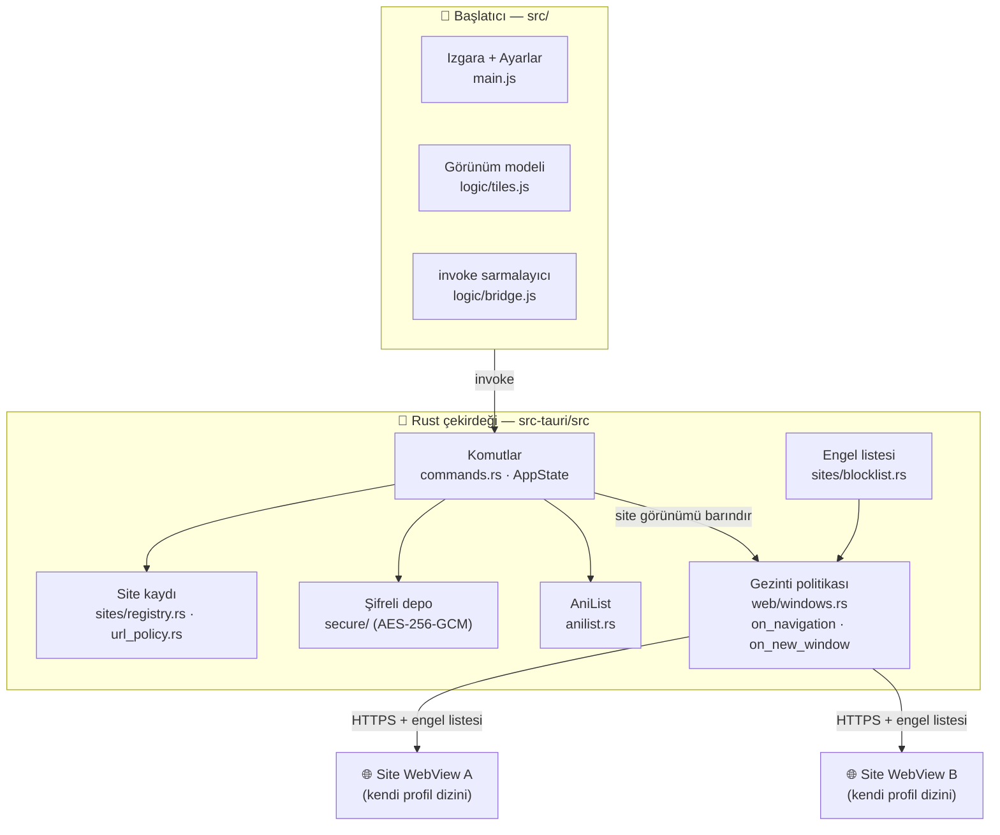

<div align="center">

<!-- Logo gömülü (base64): önizlemede de GitHub'da da ağ olmadan yüklenir.
     Yeniden üretmek için: scripts/build.sh icon -->

# AnimeHub

**Anime takip ve izleme sitelerini tek yerde toplayan; masaüstünde ve Android'de her siteyi kendi WebView profilinde açan Tauri 2 başlatıcısı.**

<br/>


[](https://github.com/mystery2430/Anime-Hub/releases/latest)
[](https://github.com/mystery2430/Anime-Hub/actions)
[](#lisans-ve-atıf)

</div>

---

## ℹ️&nbsp; Proje Hakkında

AnimeHub bir **başlatıcı**dır: tek bir siteye bağlanan bir istemci değil. Ekranda
gruplanmış bir ikon ızgarası görürsünüz, birine dokunursunuz ve site uygulama
WebView'ında açılır (yeni pencere/sekme yok; üstteki geri düğmesi veya `Esc` ile
başlatıcıya dönersiniz). Masaüstünde her site ayrı bir WebView profil **dizini**
kullanır. Android'de her site `androidx.webkit` MULTI_PROFILE ile kendi WebView
**profilini** alır (çerezler, `localStorage`/IndexedDB ve konum izinleri profil
başına ayrı); sağlayıcı bunu desteklemiyorsa site hiç açılmaz ve nedeni
kullanıcıya söylenir — sessizce ortak profile dönülmez.

0.3.4'ten kalan şifreli çerez kavanozu ilk açılışta **bir kez** içe aktarılır.
Eski `localStorage`/IndexedDB anlık görüntüleri içe aktarılmaz (aktarım
kayıplıydı ve hangi belgeye yazılacağı garanti edilemiyordu); bu yüzden bazı
sitelerde yeniden giriş gerekir ve uygulama bunu ilk çalıştırmada bir kez,
arayüzde söyler — yalnızca belgelerde değil.

İki grup vardır:

| Grup | İçerik |
|---|---|
| **Takip / Veritabanı** | MyAnimeList, AniList. AniList ayrıca uygulama içinden OAuth ile bağlanır |
| **İzleme** | OpenAnime, Animecix + sizin ekledikleriniz |

Uygulama `openani.me` gibi sitelerin içeriğini **barındırmaz, indirmaz veya
yeniden yayınlamaz**; yalnızca sizin seçtiğiniz adresi sistemin kendi WebView
motorunda açar. Sitelerin kullanım koşullarına uymak size aittir.

> [!NOTE]
> Bu proje bir topluluk çalışmasıdır; hiçbir sitenin resmî istemcisi değildir.
>
> Sürüm notları: [`CHANGELOG.md`](./CHANGELOG.md) · Güncel paketler: [Releases](https://github.com/mystery2430/Anime-Hub/releases/latest)

---

## 🏗️&nbsp; Mimari Genel Bakış

Güvenlik politikasının **çekirdeği Rust tarafındadır**: URL/gezinti politikası,
şifreli depo, IPC beyaz listesi ve OAuth. Android'de site WebView'ının kendi
kontrol noktaları Kotlin'de çalışır — üst düzey ve alt kaynak gezinti filtreleri
(`SiteNavigationPolicy` + `SiteNavigationGuard`) ile WebView ayar planı
(`SiteWebViewSettings`) — ve Rust'taki kuralla **ortak bir vektör dosyası**
üzerinden (`tests/fixtures/navigation-policy.tsv`) birebir aynı kararı verir.
Site WebView'ları hiçbir Tauri komutuna erişemez; başlatıcı arayüzü ise yalnızca
beyaz listelenmiş komutları çağırabilir.

Politikanın her platformda **nerede çalıştığı ve nerede çalışmadığı** aşağıdaki
"Hangi kontrol nerede çalışıyor? (dürüst tablo)" bölümünde. Kullanıcı engel
listesi Android'de site WebView'ına aktarılır ve iki kontrol noktasında birden
uygulanır. DNS'e dayalı özel adres kontrolü ise Android'de artık bir ön kontrol
değil, uygulama içi loopback CONNECT proxy'sinin bağlantı anındaki kararıdır:
çözülen adres ile soketin bağlandığı adres aynıdır. Masaüstünde desteklenen bir
ağ kancası olmadığı için orada yalnızca ön kontrol vardır.



| Katman | Konum | Sorumluluk |
|---|---|---|
| **Rust çekirdeği** | `src-tauri/src/*.rs` | Komutlar, site kaydı, URL politikası, şifreli depo, AniList OAuth, site görünümünü barındırma |
| **Güvenlik katmanı** | `secure/`, `sites/`, `web/` | AES-256-GCM depo, HTTPS zorunluluğu, alan adı engelleme, gezinti/yeni pencere reddi |
| **Başlatıcı arayüzü** | `src/` | Izgara, site ekleme/düzenleme, Ayarlar ve Hakkında ekranları — `innerHTML` kullanmadan |
| **Android köprüsü** | `src-tauri/android-plugin/` | Site başına WebView profili (androidx.webkit `MULTI_PROFILE`), profil bazlı temizleme/silme + karantina, Kotlin gezinti filtresi ve WebView ayar planı, AndroidKeyStore (şifreleme), Picture-in-Picture |
| **CI/CD** | `.github/workflows/` | Test matrisi, Android APK ve masaüstü paketlerinin otomatik derlenmesi |

---

## ⭐&nbsp; Öne Çıkan Özellikler

### 🪟&nbsp; Site başına izole oturum — tek pencerede

Masaüstünde her site kendi WebView profil dizinini alır:
`<uygulama verisi>/profiles/<site>`. Linux'ta WebKitGTK `data_directory`,
Windows'ta WebView2 profili kullanılır; çerezler, `localStorage`, IndexedDB
ve önbellek bu **masaüstü profilleri** arasında kesişmez.

Masaüstünde site, uygulamanın **tek penceresi içinde** siteden-siteye
değişen bir alt WebView olarak barındırılır — tarayıcı sekmesi veya OS
penceresi yerine. Pencere başlığı site adını gösterir; "siteleri tam ekran
aç" **kapalı gelir** (varsayılan pencere boyutu), Ayarlar'dan açılabilir.
Ayrıca her site WebView'ının Tauri yetkisi **yoktur**: izinler yalnızca
başlatıcı WebView'ına kapsüllüdür, şüpheli bir site Rust komutlarına
ulaşamaz.

> [!IMPORTANT]
> **Android'de yalıtım, `androidx.webkit` MULTI_PROFILE özelliğine dayanır.**
> Her site kendi profilini alır; profil adı yalnızca `site_id`'den türetilir ve
> bir "nesil" sayacı ile korunur. Sağlayıcı özelliği desteklemiyorsa site
> **açılmaz** (hata mesajı Android 10+ ve güncel WebView gerektiğini söyler) — ortak/default
> profile sessiz geri dönüş yoktur. Başlatıcının kendi profili hiçbir site
> yolunda adreslenmez.
>
> Bu bir **depolama** yalıtımıdır: çerezler, `localStorage`/IndexedDB, WebSQL ve
> konum izinleri profil başına ayrıdır. Bir **ağ güvenlik duvarı değildir** —
> sitenin hangi sunucularla konuşabileceğini sınırlamaz. Ağ tarafı için aşağıdaki
> "Sıkı gezinti politikası" bölümüne ve sınırlarına bakın.
>
> 0.3.4'ten geçiş: eski sürümün ortak kavanoz modeli, şifreli depoda duran çerez
> kavanozunu ilk açılışta **bir kez** yeni profile yazar. `localStorage` ve
> IndexedDB anlık görüntüleri içe aktarılmaz (dump kayıplıydı: indeksler, key
> path'ler ve Blob değerleri taşınmıyordu) ve diskte durmaya devam eder;
> yalnızca siz "temizle" veya "sil" derseniz silinir. Yani bazı sitelerde
> yeniden giriş gerekir.
>
> **Fiziksel cihaz testi yapılmadı.** CI aarch64 derlemesi ve birim testleri
> cihaz doğrulaması değildir; `hasCookies()` semantiği, profil silme/nesil
> davranışı, PiP ve gerçek `flush()` gecikmesi cihaz bekleyen maddeler olarak
> `docs/android-storage-isolation.md` içinde listelenir.

### 🔒&nbsp; Diskte şifreli duran veriler

AnimeHub'ın şifreli deposuna yazılan oturum anlık görüntüleri ve API anahtarları
AES-256-GCM ile şifrelenir (`AHB1` zarf biçimi). Android'de site çerezleri
artık o sitenin **kendi WebView profilinde** durur (sağlayıcının yönettiği
profil çerez deposu) ve şifreli depo sarmalayıcısına dahil değildir; depodaki
`cookies-<site>` kavanozu yalnızca 0.3.4'ten geçişte **bir kez** içe aktarılır.
Anahtar hiçbir zaman düz metin saklanmaz, platformun kendi anahtar kaynağından
gelir:

| Platform | Anahtar kaynağı |
|---|---|
| Windows | DPAPI (kullanıcı kapsamı) |
| Linux | XDG Secret Service (GNOME Anahtarlar / KWallet) |
| Android | AndroidKeyStore (donanım destekli) |
| Hiçbiri yoksa | `0600` izinli dosya — **ve Hakkında ekranında bu açıkça yazar** |

**Oturum anlık görüntüleri:** masaüstünde açık oturumun çerezleri 30 saniyede
bir şifreli depoya eşitlenir ve kapanışta son bir kayıt alınır. Android'de
`localStorage`/IndexedDB anlık görüntüsü **alınmaz** — o aktarım mekanizması
kaldırıldı: sitenin çerezleri, `localStorage`/IndexedDB verisi ve konum izinleri
kendi profilinde durur, 30 saniyelik tik yalnızca aktif site profilinin çerez
deposunu diske yazdırır (`flush`). Başlatıcının kendi (default profil) verisine
site yolları hiç dokunmaz.

### 🛡️&nbsp; Sıkı gezinti politikası

- **Yalnızca HTTPS.** `http://` adresi reddedilir, downgrade denemeleri
  native `on_navigation` callback'inde engellenir.
- **Özel/ağ içi adresler reddedilir.** `127.0.0.1`, `10.x`, `192.168.x`,
  `169.254.x`, `::1`, link-local ve `.local` gibi hedeflere gidilemez — bir
  sitenin sizi yerel ağınıza yönlendirmesi engellenir.
- **Yeni pencere/sekme istekleri varsayılan olarak reddedilir**
  (`NewWindowResponse::Deny`).
- **Aynı özel adres kuralı gezinti sırasında da uygulanır.** Bir site sizi
  `https://192.168.1.1/` adresine yönlendirmeye çalışırsa kesilir; bu kural
  `tests/audit.rs` içinde regresyon testiyle kilitlidir.
- **DNS rebinding (yalnızca masaüstü).** Herkese açık görünen bir ad, gezinti
  anında özel bir adrese çözülüyorsa kesilir. Çözümleme eşzamanlı kalır (kısa
  zaman aşımı, `web/dns.rs`); zaman aşımında/NXDOMAIN'de metin politikası
  geçerli kalır, yani **DNS kesintisi siteleri kapatmaz** (fail-open, bilinçli
  seçim). Bu kontrol gezinti anındadır: WebView'ın kendi bağlantısı bu cevabı
  kullanmaz, yani kararlı bir DNS-rebinding koruması değil, pencereyi daraltan
  bir kontroldür.
- **Alan adı engel listesi** reklam ve izleyici alanlarını masaüstünde
  **gezinti düzeyinde** (ana çerçeve) keser; liste koda gömülüdür, Ayarlar'dan
  düzenlenebilir ve kapatılabilir. Masaüstünde alt kaynak isteklerinde
  (XHR/`fetch`/görsel) böyle bir kesme noktası yoktur. Android'de liste Rust'tan
  site WebView'ine açılış ve her ayar/sıfırlama sonrasında aktarılır ve hem üst
  düzey hem alt kaynak kontrollerinde uygulanır. Aktarım başarısız olursa yeni
  site açılmaz; açık bir site varsa güvenlik için normal lifecycle yolundan
  kapatılır ve komut hata döner. Kapatma da başarısızsa kullanıcıya yeniden
  başlatma gerektiren açık bir hata gösterilir; eski snapshot ile devam
  edildiği iddia edilmez. Aktarımlar ayrıca **sıralanır**: `open_site`,
  `update_settings` ve `reset_blocklist` oturum kilidi dışında çalıştığı ve
  Kotlin tarafı "son yazan kazanır" bir atomik takas yaptığı için, eski
  ayarlardan üretilmiş gecikmiş bir snapshot yeni kuralların üzerine
  yazabilirdi. `BlocklistSyncGate` aktarımları serileştirir, snapshot'ı kilit
  **içinde** yeniden okur ve zaten iletilmiş bir generation'ı atlar; iletim
  yalnızca doğrulanmış bir push'tan sonra ilerler. Güncel olan bir aktarım
  başarılı sayıldığı için açık oturumu gereksiz yere kapatmaz.

#### Hangi kontrol nerede çalışıyor? (dürüst tablo)

| Kontrol | Masaüstü (üst düzey gezinti) | Masaüstü (alt kaynak) | Android (üst düzey) | Android (alt kaynak) |
|---|---|---|---|---|
| `http://` reddi | ✅ `on_navigation` | ⚠️ motorun mixed-content politikası | ✅ `SiteNavigationPolicy` | ✅ `shouldInterceptRequest` |
| Özel/loopback **IP literalleri** ve host kuralları | ✅ | ❌ | ✅ | ✅ |
| Kullanıcı engel listesi | ✅ | ❌ masaüstünde alt kaynak kesme noktası yok | ✅ | ✅ |
| DNS ile özel adrese çözümleme (rebinding) | ⚠️ ön kontrol; vekil kullanılırsa bağlantı denetlenen IP'ye sabitlenir — **ilk isteğin vekilden geçtiği kanıtlanmadı** (round 20) | ❌ | ✅ **CONNECT proxy'si bağlantıyı denetlenen IP'ye sabitler** (cihazda doğrulanmadı) | ✅ aynı (her istek yeni karar) |
| `data:` üst düzey belge | ✅ reddedilir | ➖ (alt kaynak olarak serbest) | ✅ reddedilir | ➖ serbest |
| **WebRTC / ICE / STUN / TURN (UDP)** | ❌ | ❌ | ❌ **proxy kapsamı dışı** (API init script ile kaldırılır — garanti değil) | ❌ |

**Android'de bağlantı artık denetlenen IP'ye sabitleniyor (round 16).**
Site WebView'ının trafiği, uygulama içindeki loopback CONNECT proxy'sinden
geçer: `androidx.webkit.ProxyController` ile **tek** bir `addProxyRule`
(`127.0.0.1:<rastgele port>`) ve `removeImplicitRules()` kurulur; `addDirect()`,
bypass kuralı veya kural içermeyen config **yoktur** ve override hiçbir zaman
temizlenmez — yani proxy çökerse istek başarısız olur, doğrudan bağlantıya
düşmez. Yeni bir site WebView'ının ilk `loadUrl` çağrısı, `setProxyOverride`
callback'i gelmeden yapılmaz (5 sn watchdog). Sağlayıcı `PROXY_OVERRIDE`
desteklemiyorsa, proxy portu bağlanamıyorsa veya callback gelmezse site
**açılmaz** ve kullanıcıya açık bir hata gösterilir; `ALLOW_AND_PROBE`'a geri
düşülmez.

Proxy yalnızca `CONNECT` kabul eder (düz HTTP reddedilir), hedefi katı biçimde
ayrıştırır, adı **bir kez** çözer, dönen her adresi mevcut `IpPolicy` ile
sınıflandırır (karışık/boş/hatalı cevap → ret) ve soketi
`InetSocketAddress(adres, port)` ile açar — ikinci bir çözümleme yoktur — sonra
`socket.inetAddress` değerini denetlediği adresle karşılaştırır. TLS hiçbir zaman
sonlandırılmaz veya araya girilmez; sertifika doğrulaması WebView'da kalır ve
sertifika hataları yutulmaz. Her yeni `CONNECT` (her redirect, her WSS/WebSocket
isteği) yeni bir karardır.

**Proxy'nin kapsamadığı trafik:** HTTP `CONNECT` yalnızca TCP taşır. Bir sayfa
`RTCPeerConnection` ile ICE/STUN/TURN için UDP açabilir ve bu trafik proxy'ye
hiç uğramaz (RFC 8828 §5.1 ilke 4; Chromium'un `WebRtcIPHandling` politikası
WebView'da ayarlanamaz). Bu yüzden Android'de init script `RTCPeerConnection`
API'sini kaldırır — ama bu bir **savunma derinliğidir, güvenlik sınırı değildir**;
WebRTC/UDP sabitlenmiş sayılmaz. Gerçek çözüm kullanıcı onayı gerektiren bir
`VpnService` filtresidir ve bu PR'ın kapsamında değildir. Ayrıntı ve cihaz testi
senaryosu: `docs/security-residual-risks.md` (round 16.1) ve
`docs/android-dns-pinning-device-checklist.md`.

**Çözümleyici (DNS) sınırı:** Android'de (API 29+, uygulamanın
`minSdkVersion`'ı) çözümleme `DnsResolver.query` + `CancellationSignal` ile
**asenkron** yapılır (`AsyncDnsResolver`): çağıran, sağlayıcı ne yaparsa yapsın
kendi 10 saniyelik son tarihinde serbest kalır; geç gelen veya yinelenen bir yanıt
uçuşu değiştiremez, yalnızca platform yuvasını bırakır; aynı host için tek uçuş
(single-flight) vardır. **İki ayrı tavan** vardır ve ikisi de 8'dir: bekleyen
mantıksal uçuşlar ve platformun henüz geri çağrımadığı sorgular — ikisinde de
fazlası kuyruğa alınmaz, reddedilir. İptal edilen bir sorgunun yuvası platform
**rapor verirse** onunla hemen kapanır (geç gelen rapor sonucu değiştiremez ama
muhasebeyi tamamlar); hiç rapor gelmezse yalnızca **bizim takip kümemizden**
iptalden 60 s sonra düşer. Bu 60 s bir **watchdog**'dur, platformun durduğunun
kanıtı değildir: genel API tamamlanma sinyali vermez, AOSP uygulaması fd'yi
kapatıp dinleyiciyi kaldırsa bile kuyruğa alınmış bir callback yine teslim
edilebilir. Bu yüzden "en fazla 8 çalışan platform sorgusu" **denmez**; en fazla
8 **izlenen** sorgu denir. Bir rapor, kapanmış uçuşu asla diriltmez ve hiçbir
adres kullanılmaz — kalan maliyet erişilebilirlik, güvenlik değil. `rcode` 0
(NOERROR) değilse yanıt adres listesi olarak **kullanılmaz**; çözümleme hatası
sayılır.
Bu çözümleyici yine sınırlı bir havuzda çalışır (`resolveMs = 10 s`, nesil
başına `resolveThreads = 4`) ve toplam iş parçacığı `resolveThreadCap = 8` ile
sınırlıdır; bu bütçe `stop()`/`start()` arasında da korunur. Tavan, tam bir
yedek nesneye izin vermek zorundadır (`>= 2 × resolveThreads`). Bütçe
tükendiğinde istek `RESOLVE_EXHAUSTED` (502) ile hemen reddedilir; bu, host
hakkında bir yargı değil **kapasite** reddidir ve `AsyncDnsResolver` ile her
işçi kendi son tarihinde boşaldığı için o son tarihten uzun sürmez. Proxy bağlanamaz veya
kuramazsa site hiç açılmaz (`proxy-unavailable`); doğrudan bağlantıya düşen bir yol
yoktur. **Cihazda
kanıtlanmayan:** gerçek sağlayıcının `CancellationSignal.cancel()` çağrısına
uyup uymadığı ve iptalden sonra geri çağrım yapıp yapmadığı — Android referansı
bunun için bir söz vermez; `AsyncDnsResolverTest` bunu fake bir lookup ile
JVM'de ölçer, cihazı değil (madde 36–39 ve 42; round 19).
Ayrıca `127.0.0.1`'e bağlanmak **yalnızca dış ağ arayüzlerini** kapatır; aynı
cihazdaki başka uygulamalar bu portu bulup kullanabilir (kimlik doğrulama
`ProxyConfig` ile mümkün değildir, açık kalan risk).

`NavigationDnsGate` / `shouldInterceptRequest` ön kontrolleri **savunma
derinliği** olarak korunur; artık garanti olarak sunulmaz. Bu ortamda Android
SDK, Gradle, cihaz veya emülatör bulunmadığı için proxy'nin WebView ile
gerçekten konuştuğu, QUIC'in kapandığı, redirect/PiP/launcher davranışı
**cihazda doğrulanmadı**; çalıştırılacak matriks
[`docs/android-dns-pinning-device-checklist.md`](docs/android-dns-pinning-device-checklist.md)
içinde. Bu nedenle DNS rebinding (R-01 b) **kapalı sayılmaz**: tasarım ve
gerçek-soket testleriyle kapatılmış, cihaz doğrulaması bekleyen bir bulgu olarak
kalır. Masaüstü aynı TOCTOU şeklini korur, çünkü orada desteklenen bir ağ kancası
yoktur.

### ➕&nbsp; Kodsuz site ekleme

**Site ekle** ile ad + URL (+ isteğe bağlı harf/renk) girersiniz; site listesi
şifreli yapılandırma dosyasına yazılır. Düzenleme, **başlatıcıdan gizleme** ve
**çerezleri ve site verilerini temizleme** de aynı menüden yapılır — yeniden
derleme gerekmez.

Kullanıcı girişi render edilmeden önce doğrulanır: şema, özel adres kontrolü,
punycode normalizasyonu ve tekrar eden adres tespiti. Arayüz hiçbir yerde
`innerHTML` kullanmaz; tüm metin `textContent` ile yazılır. Bu, `npm test`
içindeki bir testle derlenmiş çıktı üzerinde de zorlanır.

### 👤&nbsp; AniList bağlantısı

AniList, OAuth 2.0 **authorization code** akışıyla bağlanır ve GraphQL
(`graphql.anilist.co`) üzerinden kitaplık + arama sorgular. `state` parametresi
UUID v4'tür ve sabit zamanlı karşılaştırma ile doğrulanır. Dönen token şifreli
depoya yazılır; `client_id` / `client_secret` sizindir, depoya asla girmez.

Bağlantı, Ayarlar → AniList bölümündeki **"AniList ile giriş yap"**
düğmesiyle başlar: OAuth ekranı sistem tarayıcınızda açılır, yetki uygulamaya
geri döner ve durum satırı kendiliğinden güncellenir. Dönüş adresi platforma
göre değişir ve `tauri.conf.json`'daki kayıt ile birebir aynıdır:

| Platform | Dönüş adresi |
|---|---|
| Masaüstü | `http://127.0.0.1:17395/callback` (yerel dinleyici; `ANILIST_REDIRECT_URI` ile değiştirilebilir) |
| Android | `http://127.0.0.1:17395/callback` (aynı loopback dinleyicisi; özel şema kullanılmıyor) |

Gelen adres **harfi harfine** doğrulanır: şema, host, port ve yol beklenen
dönüş adresiyle uyuşmazsa (`animehub://evil/callback`, başka bir loopback portu,
uzak bir `http://` host'u) kod reddedilir; tekrarlanan `code`/`state`
parametreleri ve boş değerler de reddedilir. `state` tek kullanımlıktır ve
yalnızca eşleştiğinde kilit altında tüketilir — aynı `state` ile gelen ikinci bir
çağrı ikinci bir token değişimi başlatamaz, uydurma bir çağrı ise gerçek girişi
yakmaz. Client ID kaydedilmediyse düğme pasif görünür ve site kutucuğu siteyi
WebView'da açmaya devam eder.

> [!IMPORTANT]
> **Android'de özel şema OAuth'u kapatıldı.** `animehub://` şemasını başka bir
> uygulama da kaydettirebilir ve yetki kodu ile `state`'i alabilir. Bu yüzden
> Android'de yerel giriş yalnızca loopback dinleyicisiyle çalışır;
> `plugins.deep-link.mobile` boştur ve özel şemayla giriş state yazılmadan
> reddedilir. Kalan sınırlar
> [`docs/security-residual-risks.md`](docs/security-residual-risks.md) içinde.

### 🎨&nbsp; Tema: sistem / koyu / açık

Üst çubuktaki üç düğmeli seçici (veya Ayarlar → Görünüm) ile tema anında
değişir. **Sistem** modu işletim sisteminin açık/koyu tercihini canlı takip
eder (`prefers-color-scheme`); koyu ve açık seçimleri hem arayüzü hem de
native pencere kromunu kaplar ve şifreli ayarlara kaydedilir.

> [!NOTE]
> AniList PKCE'yi belgelemediği için akış, client secret ile kuruludur.
> MyAnimeList v1'de **bilinçli olarak** atlandı: şimdilik düz bir başlatıcı
> kutucuğu olarak açılır.

### 📱&nbsp; Android Picture-in-Picture

Ayarlar'daki **"PiP'e otomatik geç"** anahtarı, video oynatılırken ana ekrana
dönünce piP penceresinin açılmasını sağlar. PiP'e girmeden **önce** WebView
hazırlanır: sayfadaki gerçek oynatıcı bulunur, ekranda yalnızca o oynatıcı
kalır ve ancak JavaScript "hazır" dedikten sonra
`enterPictureInPictureMode()` çağrılır. Böylece PiP penceresinde sitenin
tamamı değil, yalnızca o an oynayan video görünür; PiP kapandığında sayfa
kaldığı yerden, kaydırma konumu ve oynatma durumu korunarak geri gelir.

- API 30+ (`Android 11`): `onPictureInPictureRequested()`; uygulama `true`
  döndüğü için sistem kendi (hazırlıksız) akışına karışmaz.
- API 29 (`Android 10`): `onUserLeaveHint()` geri dönüş yolu.
- Sistemin kendi otomatik girişi (`setAutoEnterEnabled(true)`) **bilinçli
  olarak** kullanılmaz: Android belgelerine göre bu ayar açıkken
  `onPictureInPictureRequested()` hiç çağrılmaz, yani PiP hazırlıksız açılırdı.
- Oynatıcı yoksa ya da hazırlık başarısızsa PiP **hiç** açılmaz ve sayfaya
  dokunulmaz; oran olarak oynatıcının kendi en-boy oranı, ölçülemezse 16:9
  kullanılır (Android'in kabul ettiği sınırlara kırpılır).

Ayrıntılı akış, oynatıcı seçim kuralları ve doğrulama durumu:
[`docs/android-pip.md`](./docs/android-pip.md).

---

## v0.3.4 — yayın ve sınırlar

**v0.3.4 için fiziksel Android testi yapılmadı.** CI derlemesi cihaz doğrulaması
anlamına gelmez; PiP, IPC, gezinti, çerez kalıcılığı ve performans cihaz testi bekliyor.
Yayımlanan v0.3.4, **ortak çerez kavanozu** modelini kullanıyordu: sağlayıcılar
arası aynı-origin `localStorage`/IndexedDB izolasyonu orada garanti edilmez ve
best-effort aktarım bir güvenlik sınırı değildir. **Çerez/oturum yaşam döngüsü**
düzeltmeleri (aktif site wipe’ın sayfa+sync’i yeniden yazmasını engellemesi,
stale Site ile yeniden oluşturmayı engelleyen re-validasyon, `STORE_LOCK`’un
seal dahil baştan tutulması) PR #26 ile eklendi.

Sonraki iş (PR #27) bu modeli Android’de **site başına WebView profili** ile
değiştirir; o değişiklik henüz yayımlanmadı ve cihazda doğrulanmadı. Yani
yukarıdaki sınır v0.3.4 için geçerliliğini korur.

Üretim paketleri PR CI ve iki release workflow kontrolünden sonra yayımlanır.
CI’daki `animehub-aarch64-debug.apk` yalnızca test içindir, GitHub Release
varlığı değildir. Ayrıntılar: [yayın prosedürü](docs/releasing.md).

## 📦&nbsp; Kurulum

Uygulama mağazalarda yayınlanmaz; doğrudan indirme ile dağıtılır.

### 🖥️&nbsp; Linux &nbsp;·&nbsp; `x86_64 — WebKitGTK 4.1`

| Yöntem | Boyut | Komut |
|---|---|---|
| **`.deb`** (Debian/Ubuntu) | ~3.1 MB | `sudo apt install ./AnimeHub_0.3.4_amd64.deb` |
| **`.rpm`** (Fedora/RHEL) | ~3.1 MB | `sudo rpm -ivh AnimeHub-0.3.4-1.x86_64.rpm` |
| **AppImage** | ~75 MB | `chmod +x AnimeHub_*.AppImage && ./AnimeHub_*.AppImage` |

```bash
sudo apt install libwebkit2gtk-4.1-0 libgtk-3-0
```

### 🖥️&nbsp; Windows &nbsp;·&nbsp; `Windows 10/11 — x86_64`

| Yöntem | Boyut | Açıklama |
|---|---|---|
| **NSIS kurulum** | ~1.9 MB | Releases sayfasından `.exe` indir, çalıştır (`currentUser` modu, yönetici gerekmez) |

> [!NOTE]
> **Windows paketleri henüz kod imzalı değildir (v0.3.4 dahil);** SmartScreen çıkarsa Ek bilgi → Yine de çalıştır. Kod imzalama altyapısı hazır — imzalı sürümler için sertifika bağlandığında (Certum OV / Microsoft Store) duyurulacak.

### 📱&nbsp; Android &nbsp;·&nbsp; `Android 10+ (API 29)`

> **Android 8.x ve 9 artık desteklenmiyor.** Bu dal `minSdkVersion` değerini
> **29 (Android 10)** yapar; site başına yalıtım `androidx.webkit`
> MULTI_PROFILE çok süreçli WebView tabanına dayanır. Android 8/9 cihazlara APK
> kurulmaz; `MULTI_PROFILE` sunmayan bir sağlayıcıda site **açılmaz** ve nedeni
> gösterilir — ortak profile sessiz dönüş yoktur. Bu, depolama yalıtımı için
> bilinçli bir kapsam kararıdır.


| Yöntem | Boyut | Açıklama |
|---|---|---|
| **İmzalı APK** | ~7–11 MB | Releases sayfasından ABI'nize uygun `.apk` (`animehub-aarch64-release.apk` çoğu modern telefon; `animehub-armv7-release.apk` eski 32-bit; `animehub-x86_64-release.apk` emülatör) |

> [!NOTE]
> Yayın APK'ları CI'da ABI başına derlenir ve yayın anahtarıyla imzalanır.
> Önceki (asenkron kalıcılaştırma değişikliğinden önceki) Android CI debug APK'sı
> bir cihazda denendi: siteler artık çökmedi, ancak yavaş açıldı. v0.3.2'deki
> değişiklik henüz fiziksel cihazda ölçülmedi; performans iyileşmesi olduğu
> doğrulanmış sayılmamalıdır.

---

## 🖥️&nbsp; Platform Desteği

| Platform | Durum | Paketler | Notlar |
|---|---|---|---|
| 🐧 **Linux** | ✅ Doğrulandı | `.deb`, `.rpm`, AppImage | Releases sayfasındaki paketler CI sürümünde üretildi |
| 🪟 **Windows** | ✅ Doğrulandı | `.exe` (NSIS) | DPAPI + WebView2 profili; kurulum Windows üzerinde elle doğrulandı |
| 🤖 **Android** | ⚠️ CI derlemesi; fiziksel test yok | 3 ABI için imzalı `.apk` | Site başına ayrı WebView profili (androidx.webkit MULTI_PROFILE): çerez/localStorage/IndexedDB site bazında izole; sağlayıcı `MULTI_PROFILE` desteklemiyorsa site açılmaz ve hata gösterilir |
| 🍎 **macOS** | ❌ Desteklenmiyor | — | Bilinçli kapsam dışı |
| 🍏 **iOS** | ❌ Desteklenmiyor | — | Bilinçli kapsam dışı |

---

## ⌨️&nbsp; Kontroller

| Girdi | İşlev |
|---|---|
| `Esc` | Açık iletişim kutusunu kapatır; hiçbiri yoksa başlatıcıya döner |
| Android geri tuşu | `Esc` ile aynı davranış |
| Site menüsü → **Düzenle** | Ad, adres, harf ve rengi değiştirir. Varsayılan olmayan sitelere fotoğraf eklenebilir |
| Site menüsü → **Başlatıcıdan gizle** | Siteyi listeden kaldırır, verisini silmez |
| Ayarlar → **Gizlenen siteler** → *Geri göster*          | Gizlenen siteyi başlatıcıya döndürür; gizleme veriyi silmez            |
| Site menüsü → **Çerezleri ve site verilerini temizle** | O sitenin tüm oturum verisini yok eder |

---

## 🔧&nbsp; Kaynaktan Derleme

### 1. Ön gereksinimler

- [Rust](https://www.rust-lang.org/tools/install) — güncel stable önerilir
  (MSRV **`1.89`**, bkz. `src-tauri/Cargo.toml`). Değer 1.77'den yükseltildi:
  kilitli grafik 1.77 ile hiç derlenmiyordu (tauri 2.11.6 → 1.77.2, RustCrypto
  0.11 ailesi → 1.85, `ctutils` 0.4.5 → 1.87, `darling`/`icu`/`keyring`/`plist`/
  `serde_with`/`time` → 1.88, `aes` 0.9.3 → **1.89**). CI, ilan edilen değeri
  `Cargo.toml`'dan okuyup o toolchain ile `cargo check --locked --all-targets`
  çalıştırır; yani iddia her koşuda ölçülür.
- [Node.js](https://nodejs.org/) 20.19+ (`package.json` `engines`; CI Node 22 kullanır)
- Linux: `libwebkit2gtk-4.1-dev libgtk-3-dev librsvg2-dev`
- Android: SDK platform 36, NDK `29.0.13846066`, `ANDROID_HOME` ve `NDK_HOME` tanımlı
- Tümü için: [Tauri ön gereksinimleri](https://v2.tauri.app/start/prerequisites/)

### 2. Klonla & çalıştır

```bash
git clone https://github.com/mystery2430/Anime-Hub.git
cd Anime-Hub
npm install

npm run tauri dev      # native pencere + hot reload
npm run dev            # yalnızca arayüz kabuğu (native özellikler olmadan)
npm run check          # frontend + Rust testleri
```

### 3. Paketleme

```bash
./scripts/build.sh linux      # AppImage + .deb + .rpm
./scripts/build.sh windows    # NSIS .exe (Windows'ta)
./scripts/build.sh android    # imzalı .apk
./scripts/build.sh test       # tüm testler
./scripts/build.sh icon       # ikonları yeniden üret
```

> [!TIP]
> Dağıtım profilinde LTO açık; `gtk`/WebKit crate'leri bağlanırken **2 GB'dan
> fazla RAM** ister. Küçük bir makinede
> `TAURI_LOW_MEMORY=1 ./scripts/build.sh linux` bu iki ayarı yalnızca derleme
> süresince gevşetir ve çıkışta `Cargo.toml`'u geri yükler.

Android imzalaması için `src-tauri/gen/android/keystore.properties` dosyasını
`.env.example` içindeki şablona göre oluşturun. **Keystore'u asla commit
etmeyin** — `.gitignore` bunu zaten engeller.

---

## 🔄&nbsp; CI/CD

| İş akışı | Tetikleyici | Ne yapar |
|---|---|---|
| `ci.yml` | her push / PR | 3 işletim sisteminde test, `fmt`, `clippy -D warnings`, `cargo audit`, gizli anahtar taraması |
| `release-android.yml` | manuel dispatch / reusable | 3 ABI için imzası doğrulanmış release APK; CI varlığı, otomatik yayın yok |
| `release-desktop.yml` | manuel dispatch / reusable | Linux `.deb`/`.rpm`/AppImage + Windows NSIS; CI varlığı, otomatik yayın yok |

`publish-release.yml`, başarılı main CI sonrası aynı SHA için iki üretim derlemesini yeniden çalıştırır. Tag/release yalnızca tüm kontroller geçtikten sonra oluşturulur; bkz. [yayın prosedürü](docs/releasing.md).

---

## 🗺️&nbsp; Yol Haritası

v1'e kadar bilinçli olarak dar tutuldu. Ertelenenler:

- [ ] MyAnimeList native entegrasyonu (v1'de yalnızca başlatıcı kutucuğu)
- [ ] Otomatik güncelleme kontrolü
- [ ] Yerel izleme geçmişi / "devam et" listesi
- [ ] macOS desteği
- [ ] Her hangi bir programa dayanmayan cookie şifreleme

---

## ✅&nbsp; Doğrulama durumu

| Doğrulama | Sonuç |
|---|---|
| `npm test` | **152 test geçti**, 0 hata (v0.3.4, yerel, 2026-10-14) |
| `cargo test --all` / `clippy -- -D warnings` / `fmt --check` | Yerelde çalıştırılmadı (Rust araç zinciri yok). Son yeşil CI koşusu daha eski bir commit'te; güncel commit için GitHub Actions'taki Tests işi (`ubuntu-24.04`, `macos-latest`, `windows-latest`) esas alınmalı |
| `cargo build --release --locked` (LTO, tek codegen unit) | GitHub Actions "Release profile (LTO)" işinde geçti |
| `cargo audit` + gizli anahtar taraması | "Dependency and secret audit" işinde geçti |
| Android derleme | CI'daki "Android compile (aarch64)" işi debug APK üretir; `release-android.yml` üç ABI için imzalı APK üretir. Bu yalnızca derlemedir; cihazda çalıştığı doğrulanmadı |
| **v0.3.1 yayın paketleri** | GitHub Release'te doğrulandı: 3 **imzalı** APK + Windows NSIS + Linux `.deb`/`.rpm`/AppImage (7/7 asset) |
| **v0.3.2 yayın paketleri** | 2026-10-07'de yayımlandı; 3 **imzalı** APK + Windows NSIS + Linux `.deb`/`.rpm`/AppImage (7/7 asset), release workflow'ları yeşil |
| Windows kurulumu | Windows üzerinde elle doğrulandı (DPAPI + WebView2 profili) |
| Bağımlılık güvenliği | `npm audit` → 0 açık; `cargo audit` CI'da her koşuda; Dependabot (cargo/npm/actions) haftalık güncelleme açar; açık bildirimi için [SECURITY.md](./SECURITY.md) |
| Frontend derlemesi | CI'da `npm run build` (Vite 8 + rolldown) her PR'da koşar; sürüm yayınında `tauri build` aynı adımı kullanır |

**Hâlâ doğrulanmayanlar:**

- **Android cihaz doğrulaması.** Önceki CI adayı bir cihazda site açarken
  çökmedi, ancak yavaş yüklendi. Site başına profil modeli (PR #27) hiç cihazda
  çalıştırılmadı: `hasCookies()` semantiği, profil silme/nesil protokolü,
  karantina davranışı, PiP/geri zinciri, gerçek `flush()` gecikmesi ve süreç
  öldürme yarışları cihaz bekliyor. Performans iddiası doğrulanmış değildir.
  Same-origin `localStorage`/IndexedDB yalıtımı artık profillere dayanıyor ve
  cihazda kanıtlanmadı; eski anlık görüntüler **içe aktarılmıyor** (kayıpsız
  olmadıkları için) — yani sorun "aktarım kayıplı" değil, "aktarım yok".
  Kontrollü PiP zinciri (hazırlık → PiP → geri yükleme) birim testleriyle
  doğrulandı ve Android hâli CI'da derlenip kurulabilir bir debug APK olarak
  paketlendi; ancak çalışma zamanı fiziksel cihazda **denenmedi**.

Tüm doğrulama kayıtları ve devralan kişiye düşen işler
[`HANDOFF.md`](./HANDOFF.md) dosyasında.

---

## 🤝&nbsp; Katkıda Bulunma

1. Değişiklikten önce [Issues](https://github.com/mystery2430/Anime-Hub/issues)
   listesine bakın.
2. `npm run check` yerelde yeşil olmalı (frontend + Rust testleri).
3. `cargo clippy --all-targets -- -D warnings` ve `cargo fmt --check` temiz
   olmalı — CI bunları zaten zorlar.
4. Güvenlik katmanına dokunan değişikliklerde `tests/security.test.js`
   içindeki varsayımları da güncelleyin.
5. Bağımlılık güncellemeleri Dependabot ile haftalık gelir; güvenlik açığı
   bildirimi için herkese açık issue açmayın — [SECURITY.md](./SECURITY.md)
   içindeki özel kanalı kullanın.

---

## 📄&nbsp; Lisans ve atıf

**MIT.** Metin [`LICENSE`](./LICENSE) dosyasında.

Bu proje **temiz oda** (clean-room) bir uygulamadır: GPLv3 lisanslı
**Dantotsu**'dan **hiçbir kod taşınmamıştır**; yalnızca API yaklaşımı
referans alınmıştır. Bu ayrımın lisans sonuçları ve tüm atıflar
[`NOTICES.md`](./NOTICES.md) dosyasındadır.

Mimari deseni — "başlatıcı ekranı + seçilen siteyi uygulama içi WebView'da açma"
— [OpenAnime-Linux](https://github.com/tuanapi/OpenAnime-Linux) ve
[OpenAnime-Desktops](https://github.com/Dark-Hunter-TR/OpenAnime-Desktops)
projelerinden esinlenmiştir. Teknoloji seçimleri (Tauri 2 / Rust) bu
projelerden alınmamıştır.

---

<div align="center">

<sub>AnimeHub hiçbir siteyle bağlantılı değildir ve içerik barındırmaz.</sub>

</div>
